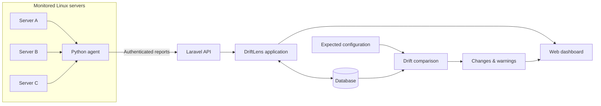

<div align="center">

# ◈ DriftLens

### See your infrastructure. Understand what changed.

**A Linux server visibility and configuration-drift platform — built with Laravel and Python.**

<br />


<br />

*One place to see your servers, their reported state, and the changes that deserve your attention.*

</div>

---

## The idea

Managing several Linux servers often means jumping between SSH sessions, commands, and configuration files just to answer simple questions: **What is running? What changed? Is this server still configured the way I expect?**

**DriftLens aims to bring that information together.** A lightweight agent on each monitored machine will collect selected system information and send it to a central Laravel application. From one dashboard, users will be able to review server inventory, inspect reported state over time, and identify differences between the expected and actual configuration of a machine.

> The goal is not to replace SSH or established monitoring tools. It is to provide a clear overview of server state and make configuration changes easier to spot.

## At a glance

| | |
|---|---|
| **Project type** | Web application + Linux agent |
| **Primary focus** | Server inventory, system visibility, configuration drift |
| **Backend** | PHP · Laravel |
| **Collection agent** | Python · Linux |
| **Data storage** | PostgreSQL (planned) |
| **Deployment** | Docker (planned) |
| **Project status** | Early development |

## How it is intended to work

DriftLens is being designed around three parts: a central web application, a small agent installed on monitored Linux servers, and a comparison layer that checks reported state against user-defined expectations.



*This diagram represents the target architecture; components are being developed incrementally.*

## What DriftLens aims to provide

### 🖥️ Server inventory
A central place to register servers and review basic information such as hostname, operating system, and last report time.

### 📊 System visibility
Readable reports covering selected resource and system information, including CPU and memory usage, disk space, running services, listening ports, and Docker containers where available.

### 🐍 Lightweight collection agent
A Python agent that gathers a defined set of information locally and sends structured reports to the application through an authenticated API.

### 🔎 Configuration drift detection
Compare the state reported by a server with configuration rules defined in DriftLens. For example, identify an unexpected listening port, a stopped service, or a container that is no longer running.

### 🕓 Report history
Keep previous reports so users can review how a server's reported state changes over time.

### 🔔 Warnings and alerts
Make noteworthy differences visible instead of requiring users to manually compare system output.

> These are planned capabilities, not a claim that every feature is already implemented.

## Technology direction

| Technology | Intended role |
|---|---|
| **PHP / Laravel** | Web application, API, authentication, and application logic |
| **Python** | Lightweight Linux data-collection agent |
| **PostgreSQL** | Persistent storage for servers, reports, and configuration rules |
| **Linux** | Operating environment for monitored machines and the agent |
| **Docker / Compose** | Reproducible development and deployment environment |
| **Git / GitHub** | Version control and project collaboration |

The stack may evolve as the project develops. The first priority is to build a working end-to-end flow before adding more infrastructure.

## Development roadmap

The project is intentionally being built in stages. The checklist below reflects the current direction, not a promise that every item is complete.

- [x] Initialize the Laravel application and local Git repository
- [ ] Build server registration and inventory management
- [ ] Design the database for servers and incoming reports
- [ ] Create an authenticated API endpoint for server reports
- [ ] Build the first Python collector and JSON report format
- [ ] Send a report from a Linux machine to DriftLens
- [ ] Display server information and report history in the dashboard
- [ ] Define expected configuration rules
- [ ] Detect and display configuration drift
- [ ] Containerize the application and document deployment
- [ ] Add automated checks and improve operational visibility

## Getting started

DriftLens is at an early stage. The Laravel application has been initialized, but the server-management features and Python agent are still on the roadmap.

### Prerequisites

- PHP and Composer, with the PHP extensions required by the Laravel application
- Node.js and npm
- Git
- A supported database configured for the application

### Run the Laravel application locally

```bash
# Clone the repository
git clone git@github.com:YOUR_USERNAME/driftlens.git
cd driftlens

# Install PHP dependencies
composer install

# Create your local environment file
cp .env.example .env

# Generate the Laravel application key
php artisan key:generate
```

Configure the database connection in `.env` before running migrations. For PostgreSQL, set `DB_CONNECTION=pgsql` and provide the relevant database name, username, password, host, and port. Make sure the matching PHP database extension is installed.

```bash
# Create / update the database schema
php artisan migrate

# Install frontend dependencies and build assets
npm install
npm run build

# Start the local development environment
composer run dev
```

The application should then be available at the local URL printed by Laravel's development server (commonly `http://localhost:8000`).

## Design principles

- **Visibility first:** show useful, understandable information rather than overwhelming users with raw system output.
- **Small agent, clear contract:** keep collection focused and send structured reports through a documented API.
- **Secure by design:** authenticate agent reports, protect credentials, and use least-privilege access.
- **No surprise automation:** begin with detection and explanation; any future server-side actions must be deliberate and safely controlled.
- **Build in verifiable steps:** test the full path from a monitored machine to the dashboard before expanding the feature set.

## Project status

DriftLens is an actively developed personal university and portfolio project. The architecture and feature set will become more concrete as each stage is implemented. Documentation will be updated alongside working functionality.

---

<div align="center">

**DriftLens** · From server state to a clearer picture of your infrastructure.

<sub>Built step by step. Designed for Linux. Focused on the details that change.</sub>

</div>
